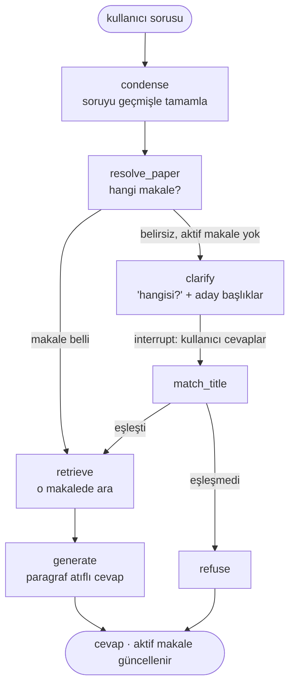

# M2 tasarımı: sohbet içinde makale bulan LangGraph agent'ı

Tarih: 2026-10-21 · Durum: taslak (onay bekliyor) · Önceki: `docs/decisions/002-m1b-pipeline.md`

## 1. Amaç ve neden

M1'de soru her zaman makalesiyle birlikte geliyordu (`single_paper` modu). Gerçek bir kullanıcı
makaleyi söylemez, bir sohbette art arda soru sorar ve bazen makale değiştirir. M2 paperlens'i
bu duruma taşır. Hedef, şunları yapan bir **LangGraph** agent'ı:

- 281 makalenin hepsinde arama yapar (corpus modu),
- takip sorularını sohbet geçmişiyle tamamlar,
- "aktif makale"yi hatırlar, makale değişimini yakalar,
- emin olamadığında "hangisi?" diye sorar,
- kaynak göstererek cevap verir.

Akış tek cümleyle: **soruyu geçmişle tamamla → makaleyi bul (gerekirse sor) → ara → cevapla.**

Bu bir portföy projesi. Amaç LangGraph (state, koşullu kenarlar, checkpointer, `interrupt`),
conversational RAG ve **MLflow tracing**'i çalışan ve mülakatta iki cümleyle anlatılabilen bir
sistemde öğrenmek. Araştırma titizliği hedeflenmiyor; tek kurulum ve tek dürüst karşılaştırma
yapılıyor.

## 2. Hedefler, hedef olmayanlar, anti-hedefler

**Hedefler**
- `src/paperlens/graph/` altında 5 node'lu ve bir interrupt'lı LangGraph akışı (bölüm 4).
- Aynı 250 sorudan (validation, seed 13) deterministik olarak kurulmuş çok makaleli sohbetler
  (bölüm 5).
- Üç sistemin karşılaştırması (bölüm 6):
  - `m1b_best`: makale verili, tavan.
  - `corpus_rag`: tek aramalı, durumsuz.
  - `m2_agent`.
- 4 yönlendirme metriği.
- MLflow'da her sohbet için bir trace; README'de örnek sohbetler.
- Takip sorusu tamamlamayı gösteren ~10 elle yazılmış demo sohbeti (metrik değil, vitrin).

**Hedef olmayanlar (M2'de yok)**
- "Kanıt yeterli mi → sorguyu yeniden yaz" döngüsü (grade/rewrite). Arama zaten tek makaleye
  filtreli. Kanıt çıkmıyorsa sebep genelde cevabın makalede olmaması, kötü yazılmış bir sorgu
  değil. Daha sonra eklenebilir.
- Groundedness kontrolü, birden fazla makaleyi karşılaştıran sorular.
- Serbest tool-calling (ReAct) agent'ı. Küçük yerel modelle bilinçli olarak sabit bir graf
  kullanılıyor.
- LLM ile simüle edilen kullanıcı (simüle kullanıcı kural tabanlı), LLM router ablation'ı.
- FastAPI/SSE, Langfuse (tracing MLflow ile yapılıyor; orijinal spekteki Langfuse'un yerine).
- Geniş ablation ızgarası. Kullanıcı (Enes) yalnızca eşiği ayarlar.

**Anti-hedefler (çalışsa bile başarısızlık sayılır)**
- Agent'ın neredeyse her turda "hangisi?" diye sorması.
- Makale adıyla anıldığı halde agent'ın eski makaleden cevap vermesi.
- Doğru makale bilgisinin (`paper_id`, doğru başlık) agent'a ya da `corpus_rag`'e sızması. Agent
  doğru makaleyi yalnızca iki yoldan öğrenebilir: sorudaki makale adından ya da simüle
  kullanıcının netleştirme cevabından.
- Hard-code: eşikler, şablonlar ve seed'ler config'de durur.

## 3. Kısıtlar

- Yalnızca yerel modeller:
  - üretim ve condense: `ministral-3:14b` (Ollama),
  - judge: `qwen3:14b`,
  - embedding: `bge-m3`.
- Mevcut index'ler ve `Retriever` yeniden kullanılır, `m1b_best` ayarlarıyla: section chunk 200,
  dense top-5, paragraf atıfı. Index yeniden kurulmaz.
- Config-driven:
  - Yeni ayarlar `AppConfig` altında `agent:` ve `conversations:` bölümlerinde durur ve
    `docs/CONFIG.md`'ye işlenir.
  - Her yeni dosyada mevcut docstring kalıbı kullanılır (Purpose/Flow/Params/Try).
- Yeni bağımlılık `langgraph` (1.x). MLflow zaten var (`mlflow>=3.1`).
- Commit'ler kullanıcının kimliğiyle atılır, Claude atfı satırı eklenmez. Her push için onay
  alınır.

## 4. LangGraph akışı

### 4.1 State

| Alan | Açıklama |
|---|---|
| `messages` | Sohbet geçmişi |
| `question` | Orijinal soru |
| `standalone_question` | `condense` çıktısı |
| `active_paper_id` | Turlar arası kalıcı |
| `decision` | `named`, `vote`, `stay` ya da `clarify` |
| `candidates` | Makale başına oy payları |
| `chunks` | Bulunan chunk'lar |
| `answer` | Üretilen cevap |
| `clarified` | Bu turda netleştirme yapıldı mı |

Turlar arası kalıcılık LangGraph checkpointer ile sağlanır; `thread_id` sohbet id'sidir. Eval'de
`InMemorySaver` kullanılır (benim kararım).

### 4.2 Node'lar

| Node | İş | Config |
|---|---|---|
| `condense` | Geçmiş boşsa soruyu aynen geçirir. Değilse LLM soruyu tek başına anlaşılır hale getirir ("peki baseline ne?" → "what is the baseline of the model discussed above?"). Makale başlığı eklemez; makaleyi state'teki aktif makale taşır. | `agent.condense.enabled`, `prompts/condense.md` |
| `resolve_paper` | Kural aşağıda; LLM çağrısı yok. | `agent.route.*` |
| `clarify` | En iyi N adayın başlığıyla "hangisini kastediyorsunuz?" diye sorar, `interrupt()` ile durur. | `agent.clarify.max_candidates` (3) |
| `match_title` | Kullanıcı cevabını önce adaylarla, sonra bütün başlıklarla rapidfuzz ile eşler. | `agent.route.title_match_min` |
| `retrieve` | Mevcut `Retriever.retrieve(query, paper_id)`. | `retrieval.*` |
| `generate` | `m1b_best`'in üretim promptunu ve paragraf atıfını kullanır. Prompttaki başlık çözülen makalenin başlığıdır. Ret serbesttir. | `generation.*` |
| `refuse` | Makale çözülemedi; ret cevabı döner (`refused: true`). | — |

### 4.3 `resolve_paper` kuralı (tek eşik)

1. **named:** Soru bir makaleyi adıyla anıyorsa o makale seçilir. Ad tam başlık da olabilir,
   kısa adı da (bölüm 5'teki şablonlar). Aktif makaleden farklıysa bu bir geçiştir.
2. **vote:** Soru corpus'ta aranır (dense, filtresiz, `route.top_k`=10 chunk) ve chunk'lar
   makaleye göre oylanır. `lead = share1 - share2 ≥ route.min_lead` ise kazanan makale seçilir.
   Kazanan aktif makaleden farklıysa bu bir geçiştir.
3. Fark yeterli değilse:
   - aktif makale varsa **stay**,
   - yoksa **clarify**.

Ayarlanan eşik yalnızca `route.min_lead`'dir (başlangıç değeri 0.3). Eşleşme eşiği
`title_match_min`'dir (başlangıç değeri 90).

Bu kuralın üç bilinçli sonucu var:
- **Aktif makale varken agent sormaz.** Sinyalsiz bir geçişte genel bir soru ("Which dataset do
  they use?") gelirse aktif makalede kalır. İnsan da öyle yapardı.
- **Aktif makale yalnızca `refuse` ile temizlenir.** `generate`'in "Unanswerable" cevabı aktif
  makaleyi silmez: makale doğru olabilir, sadece cevap olmayabilir (benim kararım).
- **Başlık embed edilen chunk metnine eklenmez.** Başlıklar mevcut `titles` eşlemesinden okunur
  ve index yeniden kurulmaz (benim kararım).

## 5. Sohbetler (değerlendirme verisi)

**Kaynak:** `m1b_best` ile aynı 250 soru.
- 171 makaleye dağılıyor: 110 makalede 1, 43'ünde 2, 18'inde 3 soru var.
- Her soru tam bir kez kullanılır.
- Sohbetler sabit seed ile üretilir, `evals/conversations/m2.jsonl` dosyasına yazılır ve
  commit'lenir.

**Sohbet yapısı:**
- Her sohbette `papers_per_conversation` (3) makale ve onların bütün soruları vardır.
- Sorular makale blokları halinde gelir.
- 2+ sorulu bir makalenin son sorusu `return_prob` (0.5) olasılıkla başka bir bloğun arkasına
  taşınır. Bu, eski makaleye dönüşü test eder.
- Yaklaşık 57 sohbet çıkar.

**Tur tipleri:**

| Tip | Anlamı |
|---|---|
| `first` | Sohbetin ilk sorusu |
| `same` | Makale önceki turla aynı |
| `switch_signaled` | Makale değişti ve soru makaleyi adıyla anıyor |
| `switch_unsignaled` | Makale değişti ve soru olduğu gibi geliyor |

**Sinyal şablonları:** Makalenin değiştiği turlar ve `first` turları `signal_prob` (0.5)
olasılıkla sinyalli olur. Şablon sabit seed ile şu listeden seçilir:
- `In the paper "{title}", {question}` (tam başlık),
- `In {short_title}, {question}` (kısa ad),
- `About the {short_title} paper: {question}` (kısa ad).

`short_title` başlığın ":" öncesi kısmıdır; ":" yoksa ilk 4 kelimedir. Sorunun ilk harfi
küçültülür. Şablonlar LLM ile üretilmez. Yakalama oranı şablon başına raporlanır; böylece testin
şablonu değil agent'ı ölçtüğü görülür.

**Simüle kullanıcı:** Agent `clarify` ile sorarsa doğru makalenin tam başlığıyla cevap verir.
Bir turda en fazla 1 netleştirme yapılır; agent yine çözemezse tur ret olarak puanlanır.

**Takip demosu:** Bu kısım metrik değildir.
- `evals/conversations/followups_demo.jsonl` dosyasında ~10 kısa sohbet bulunur. Gerçek QASPER
  makaleleri kullanılır, takip soruları elle yazılır (ör. "What dataset do they use?" → "And how
  big is it?").
- Amaç `condense` adımını göstermektir.
- README'ye 2-3 tanesi trace'iyle eklenir.

## 6. Sistemler ve metrikler

| Sistem | Nasıl çalışır | Config |
|---|---|---|
| `m1b_best` | Doğru makale verili (tavan). Mevcut sonuçlar kullanılır, tekrar koşulmaz. | `m1b_best.yaml` |
| `corpus_rag` | `BaselinePipeline` filtresiz arar. Her soru bağımsızdır, geçmiş yoktur. Sohbet şablonu uygulanmış soruları görür. Prompttaki `{{title}}` en üstteki chunk'ın makalesinden gelir (benim kararım). Bunun için `BaselinePipeline`'a, `question.paper_id`'yi filtreye ve başlığa bağlamayan bir corpus modu eklenir. | `m2_corpus_rag.yaml` |
| `m2_agent` | Bölüm 4'teki graf, sohbet sırasıyla koşar. | `m2_agent.yaml` |

**Cevap metrikleri (üç sistem için):**
- answer_f1 ve evidence_f1.
- Judge doğruluğu: ikincil, yalnızca yön olarak okunur.
- `m2_agent`, mevcut paired bootstrap ile hem `corpus_rag` hem `m1b_best` ile karşılaştırılır.
- Kırılım tur tipine göre yapılır.
- `m2_agent` için iki satır raporlanır: **bütün turlar** ve **netleştirme yapılmayan turlar**.
  Sebep: simüle kullanıcı her zaman doğru başlığı verdiği için soru sormak puanı bedavaya
  yükseltir. İki satır bunu görünür kılar.

**Yönlendirme metrikleri (4 tane):**
1. Tur tipine göre makale doğruluğu. Doğru sayılması için cevabın dayandığı makale doğru makale
   olmalı. `corpus_rag` için en üstteki makaleye bakılır.
2. Sinyalli geçiş yakalama oranı, şablon başına.
3. Netleştirme oranı.
4. Yanlış makaleden cevap oranı: soru sormadan, ret olmadan, yanlış makaleden verilen cevaplar.

**Operasyon metrikleri:** tur başına LLM çağrısı sayısı, p50/p95 gecikme, `condense`'in soruyu
değiştirdiği tur oranı. Son metrik bir kontrol işlevi görür: QASPER soruları zaten tek başına
anlaşılır, bu yüzden oranın düşük olması beklenir.

**Çıktılar:**
- `evals/results/m2_agent/` ve `evals/results/m2_corpus_rag/`, mevcut `report.md` ve
  `params.json` biçiminde. Rapora bir yönlendirme tablosu eklenir.
- Tur bazlı kayıtlar: `decision`, aktif makale, adaylar, netleştirme metni.
- MLflow run'ı ve güncellenmiş `SUMMARY.md`.

## 7. MLflow tracing

- `agent.tracing: true` iken graf çalışmaları MLflow trace olarak kaydedilir. Bağlantı ya
  `mlflow.langchain.autolog()` ya da node'larda `@mlflow.trace` ile yapılır; seçimi builder
  yapar.
- Her sohbet bir trace'tir, her node bir span'dır. Span'larda karar, oy payları ve tamamlanmış
  soru görünür.
- Trace'ler aynı `mlflow.db`'ye yazılır ve `uv run mlflow ui` ile görülür.

## 8. Dokümantasyon ve teslim

- `docs/decisions/003-m2-agent.md`: sonuç tablosu, eşik seçimi, sınırlamalar. Sınırlamalardan
  biri: QASPER soruları tek başına anlaşılır olduğu için `condense` yalnızca demo ile
  gösterilebiliyor.
- `docs/m2_ozet_tr.md`: Türkçe özet. README'ye M2 bölümü, diyagram ve örnek sohbetler eklenir.
  Makefile'a `m2` hedefi eklenir.
- Testler fake LLM ve fake index ile yazılır (mevcut `llm/fake.py` kalıbı). Kapsanacaklar:
  - yönlendirme kuralları,
  - sohbet üretiminin determinizmi,
  - her sorunun bir kez kullanılması,
  - `paper_id` sızmaması.
- CI yeşil kalır.
- Final: ayarlar dondurulduktan sonra test split'inde tek koşu yapılır. Kullanıcı onayıyla,
  ayrı bir commit olarak.

## 9. Builder'a bırakılanlar

- Sohbet üretim algoritmasının ayrıntısı (bölüm 5'teki şartlar korunarak).
- `condense` promptunun metni (`prompts/` altında, açıklamasıyla birlikte).
- Kısa ad eşleştirme yöntemi. Şart: bölüm 5'teki üç şablonun hepsi yakalanabilmeli.
- MLflow tracing'in nasıl bağlanacağı.
- Modüllere bölme (`graph/state.py`, `graph/nodes.py`, `graph/build.py`,
  `evals/conversations.py` gibi). Mevcut `pipelines/factory.py` kalıbına uyulur.
