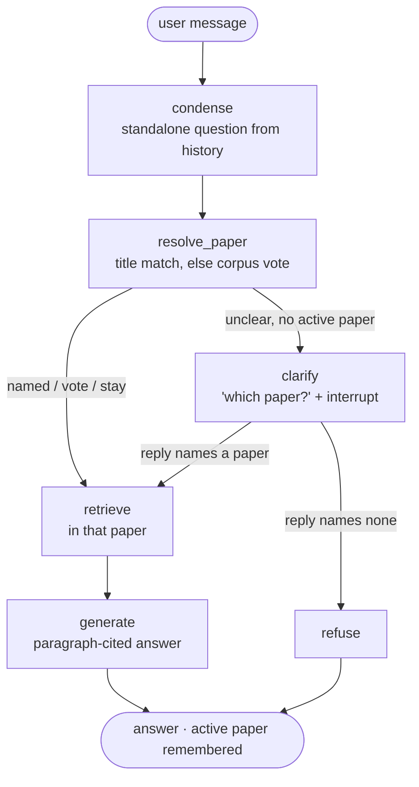

# graph

The M2 conversational agent: a LangGraph `StateGraph` that finds the paper a chat turn is
about, then answers it with the M1b pipeline.

| File | Role |
|---|---|
| `state.py` | `AgentState`: per-turn fields plus `history` and `active_paper_id`, which the checkpointer keeps between turns (one thread = one conversation) |
| `routing.py` | Pure rules, no LLM: `vote()` (paper shares of the corpus top-k), `match_title()` (full title fuzzy, short title exact), `decide()` -> `named` / `vote` / `stay` / `clarify` |
| `nodes.py` | The six nodes. `clarify` calls `interrupt()`; the caller resumes with `Command(resume=<reply>)` |
| `build.py` | `build_graph(deps, checkpointer)`, `build_agent_deps(cfg, bundle, llm, titles)`, `make_checkpointer()` |
| `converse.py` | Runs hand-written follow-up chats and writes a transcript (`paperlens converse`) |

Design choices:
- **Fixed graph, not a tool-calling agent.** A 14B local model is more reliable when the flow is
  explicit, and every decision is visible as one span in the MLflow trace.
- **Routing is deterministic.** The only tunable is `agent.route.min_lead`.
- **With an active paper the agent never asks.** An unclear question means "same paper",
  as a person would assume. A question that names another paper switches.
- **No gold leak.** The nodes never read `Question.paper_id`. In the eval, the simulated user's
  reply (the gold title) is the only way the right paper reaches the agent.
